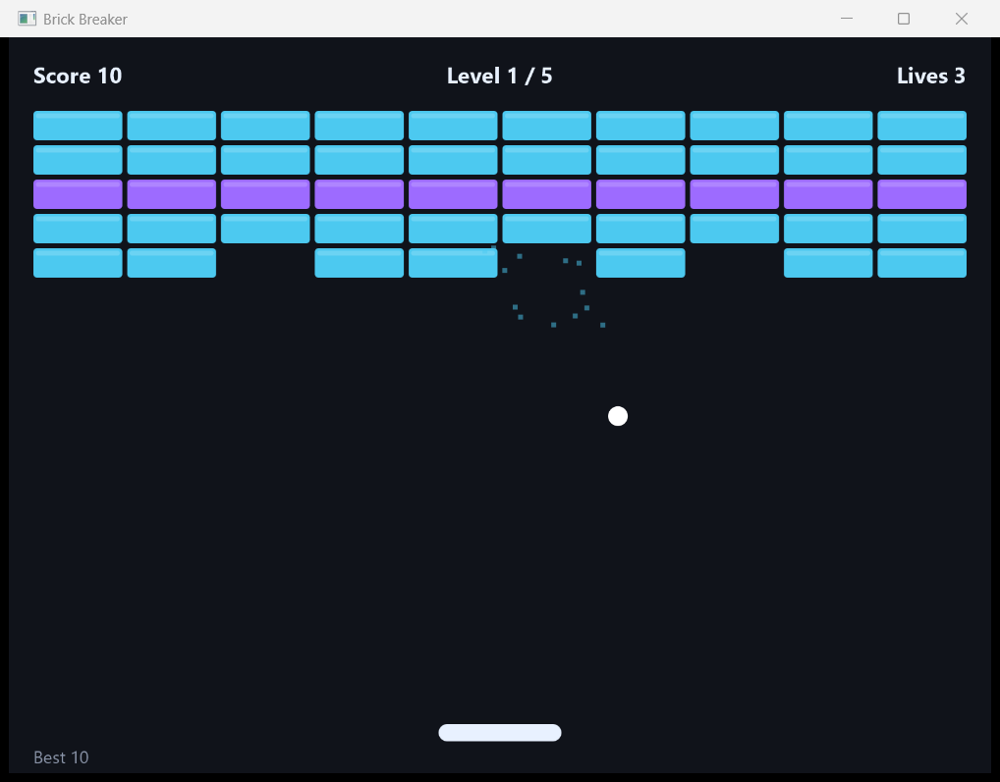

# Brick Breaker

[](https://github.com/JitShen/brick-breaker/actions/workflows/build.yml)

A brick-breaker arcade game written in Java 21 and JavaFX. Aim with the paddle, break the wall, catch
power-ups, and clear all five levels.



## Features

- **Aimable bounces:** where the ball lands on the paddle sets its angle, up to 60° at the edges.
- **Four brick types:** 1-hit, 2-hit and 3-hit bricks (they fade as they take damage), plus
  unbreakable bricks you have to play around.
- **Five levels**, each loaded from a plain text file.
- **Power-ups:** wide paddle (W), multi-ball (M), slow ball (S) and extra life (+).
- **High score** saved between sessions.
- Particle bursts, hit flashes, a title screen, pause menu, and a window that can be resized to any
  shape. The game pauses itself when the window loses focus.

## Controls

| Action | Keys |
|---|---|
| Move paddle | `A` / `D`, `←` / `→`, or the mouse |
| Launch ball | `Space` or click |
| Pause / resume | `Esc` or `P` |
| Quit to title (while paused) | `Q` |
| Play again (after the game ends) | `R` |

## Running it

You need **JDK 21**. Gradle is downloaded automatically by the wrapper.

```bash
./gradlew run      # play the game
./gradlew test     # run the tests
./gradlew build    # compile and test everything
```

On Windows, use `gradlew.bat` in place of `./gradlew`.

## How it's built

```
src/main/java/io/github/jitshen/brickbreaker/
├── model/   game rules: plain Java, no UI code, fully unit-tested
├── ui/      JavaFX: game loop, drawing, input, effects, screens
└── score/   saves the high score to ~/.brick-breaker/highscore.properties
```

- **Rules and drawing are kept apart.** `Game.update(dt, input)` advances the world and returns a list
  of events (brick hit, life lost, power-up caught…). The UI draws the world and reacts to the events
  with effects. The model never imports JavaFX, and a test checks that.
- **Fixed time step.** The loop always simulates the game in 1/120 s steps, however fast the screen
  refreshes, so the game plays the same on every machine.
- **Swept collision.** Each step checks the ball's whole path against walls, the paddle and bricks,
  not just where it ends up. A fast ball can't skip through a brick, even after a long frame.
- **Levels are text files** in `src/main/resources/levels/`, listed in play order in `levels.txt`:

  ```
  ; comment lines start with a semicolon
  3333333333
  2222222222
  1111111111
  ##..##..##
  ```

  `.` is empty, `1`–`3` are bricks with that many hit points, `#` is unbreakable. Every row must be
  the same width. A broken level file fails with a message that names the level and the problem.

## Remembrance

This project started from **COMP2042_CW_hfyjg6**, my university coursework for COMP2042. It was the first
time I worked properly on a game in Java, and it's why I wanted to build one of my own.

This repository is a complete rewrite. No code from that coursework is used here.

## Licence

[MIT](LICENSE)
